# Hip MRI image generation using DCGAN
Christopher Zhang - s4703439

# Problem
<!-- SSIM means: "For each generated image, how structurally similar is it to the single most similar real image?" -->

<!-- What it tells you

FID              Distribution similarity
SSIM             Structural/pixel similarity
Generated images Visual quality
G/D losses       Training dynamics
Generation time  Computational performance
GPU memory       Resource requirements 

Investigate: General Engineering & Research Guidelines
1. Pipeline Setup & Training Stability: Implement appropriate loss formulations (e.g., Wasserstein   tance with gradient penalty, 
discrete codebook quantization, or latent diffusion schedules). Address training stability and gradient hygiene.
2. Baseline Implementation & Comparison: Implement an initial generative baseline (e.g., standard DCGAN or basic autoencoder) to 
establish a benchmark. Compare your chosen model
from the table below against this baseline on sample clarity, diversity, and fidelity. 
3. Quantitative Benchmarking: Compute Structural Similarity Index (SSIM > 0.6) across synthesized cohorts against reference 
anatomical slices. Measure distribution fidelity (FID, feature coverage, or latent distance metrics). 
Profile GPU memory, training stability, and generation runtime.
4. Qualitative Autopsy & Memorization Audit: Display uncurated sample grids across diverse random seeds (avoid cherry-picking). 
For style-based or diffusion models, provide a 2D t-SNE or UMAP embedding plot comparing real and synthetic distributions. 
Conduct a failure autopsy on 3–5 flawed generations (checkerboard artifacts, distorted tissue margins, mode drops) 
and audit nearest training neighbors to disprove patient memorization. -->


Generartive models allow synthesizing realistic synthetic cohorts without comprimising on patient anonymity. To do this, DC-GAN ()

We are first starting with DCGAN. Use the HipMRI 2D slices (`keras_slices_data`)
Reasonably clear image with SSIM > 0.6.

The purpose of this assignment is to synthesize artificial HipMRI data for medical training and imaging purposes.


Segmentation dataset isn't required; since we are running a generative model.

Modules.py should contain the code for both? perhaps the basic encoder can be in a separate python file.

<!-- This gives you a nice experimental question:
How does a VAE compare with a DCGAN for generating anatomically plausible 2D hip MRI slices?
You could then use the same dataset and preprocessing for both.
For example:    
    │      Evaluation    │
    │ SSIM               │
    │ FID                │
    │ Diversity          │
    │ Coverage           │
    │ Visual quality     │
    │ Failure analysis   │
    │ Memorization audit │
-->

<!-- What to include in your report
- Uncurated grids from multiple seeds.
- A distribution embedding if applicable to your model.
- Three to five genuine failure cases with explanations.
- A nearest-neighbour comparison grid and similarity statistics.
- A conclusion discussing diversity, anatomical quality, possible memorization, and limitations
-->

<!-- `modules.py`: containing the source code of the components for your model. Each component must be implemented as a class/function 
    in pytorch, or TF/Keras. (I will probably be using pytorch). The model should not depend on numpy, in any way unless otherwise 
    approved by the teaching staff.
`dataset.py`: Data loader for loading and pre-processing of your data, including leakage-free train/validations/test splitting 
    functions and data augmentations.
`train.py` : Code for training, validating testing and saving of the model. Perhaps test on the CPU node first with a 
    lower-power model. This module should be imported from `modules.py` and the data loader shold be imported from `dataset.py`. 
    Ensure that losses and metrixs are plotted during training.
`predict.py` Show an example usage of the trained model. It should load the saved model weights, run inference on test cases, 
    print out any results, and provide visualizations were applicable (e.g. prediction overlays, generated samples and heatmaps). 
    Numpy is allowed for visualization or loading of the data.
`README.md` Document the project, working principles, feasibility review, experiments and instructions. -->


# Feasibility Review 
(From S3, 1 page)
Intended User: Medical students who need synthetic Hip MRI data so that they can test while maintaining patient privacy.

DIFFICULTY: Normal.

Chosen model(s): Variatonal autoencoder, DCGAN. Purpose of the models is to generate synthetic images; this report serves to compare the two models.

Feasibility: The model was first tested on the CIFAR-10 Dataset, batch-size 32 and 30 epochs. It was able to generate synthetic data with 30 epochs; 20 epochs isn’t sufficient enough. The CIFAR10 Dataset is 32x32; whereas the HipMRI Dataset is a bit more. This was compared with the basic auto-encoder. Once these models worked, a similar model was tested on the HIPMRI dataset on the CPU and was able to run successfully.

Verification is done by splitting the dataset into test, validation and training vectors; this was done already in the supplied dataset.

Risks: The model doesn’t generate adequately detailed synthetic data without excessive training time. The model generates, but it falls into model collapse due to insufficient data variability. 


# Dataset and Model Descripton, Training process
<!-- All preprocessing is performed in dataset.py using the HipMRIDataset class, which handles NIfTI medical imaging files and prepares them for GAN training. -->
The purpose of this project is to compare a generative model with another in order to understand the benefits and drawbacks of both the model, and a simpler baseline model.

I have chosen to use the variational autoencoder and DC-GAN to generate the images; since they are relatively simple to implement, have some drawbacks, and I will have to compare two models. Below is the description of both models; and how they were trained.


## Description of the Dataset
The dataset is the Hip-MRI dataset. It is split into 8 weeks, from week 0 to week 7. The training dataset has 11460 images; there are 32 people in the training dataset; from case 4 to case 35; 3 people in the validation dataset, from case 36 to 39, and 3 people in the test dataset; case 40 to 42.

For my experiment, in order to get more controlled data, I will only be using week 4 and week 7 of the dataset; although it is possible to train on the entire model, the resulting generated data would not be able to distinguish the week data.

## DC-GAN
GANs use a generator and a discriminator. Both models must compete with each-other during the training loop; the discriminator must be able to distinguish if the images created by the generator are real. DC-gan extends this by using a deep convolutional network; 

- replace pooling layers with strided convolutions.
- use batchnorm for both the generator and discriminator.
- Remove fully connected hidden layers for deeper architectures.
- Use ReLU activation in the generator for all layers, except the output, which uses Tanh.
- Use LeakyReLU activation for all layers of the discriminator.

The DCGAN design principles proposed by [1] were used in this report, too. 
- The generator uses successive transposed convolutional layers to upsample a 100-dimensional latent noise vector into a 256 × 128 grayscale image. Batch normalisation and ReLU activations are applied throughout the intermediate layers, with a final Tanh activation to constrain the generated pixel values to [-1, 1].

- The discriminator uses successive strided convolutional layers to extract increasingly high-level image features while reducing spatial dimensions. LeakyReLU activations are used between convolutional layers, with a final convolution producing a single authenticity score.

After each generator convolution layer, batch normalization was applied after each intermediate transposed convolution. The idea is that the discriminator must convert a 128*256 grayscale image into a single 100-unit vector via strided convolution.

To make this clearer, the architectures can be displayed onto tables:

### Generator architecture

| Layer | Output shape (C × H × W) | Configuration | Activation |
|---|---|---|---|
| Input | 100 × 1 × 1 | Latent vector | — |
| ConvTranspose2d | 512 × 8 × 4 | Kernel 8×4, stride 1 | ReLU |
| ConvTranspose2d | 256 × 16 × 8 | Kernel 4×4, stride 2, padding 1 | ReLU |
| ConvTranspose2d | 128 × 32 × 16 | Kernel 4×4, stride 2, padding 1 | ReLU |
| ConvTranspose2d | 64 × 64 × 32 | Kernel 4×4, stride 2, padding 1 | ReLU |
| ConvTranspose2d | 32 × 128 × 64 | Kernel 4×4, stride 2, padding 1 | ReLU |
| ConvTranspose2d | 1 × 256 × 128 | Kernel 4×4, stride 2, padding 1 | Tanh |

### Discriminator architecture

| Layer | Output shape (C × H × W) | Configuration | Activation |
|---|---|---|---|
| Input | 1 × 256 × 128 | Grayscale image | — |
| Conv2d | 64 × 128 × 64 | Kernel 4×4, stride 2, padding 1 | LeakyReLU (0.2) |
| Conv2d | 128 × 64 × 32 | Kernel 4×4, stride 2, padding 1 | LeakyReLU (0.2) |
| Conv2d | 256 × 32 × 16 | Kernel 4×4, stride 2, padding 1 | LeakyReLU (0.2) |
| Conv2d | 512 × 16 × 8 | Kernel 4×4, stride 2, padding 1 | LeakyReLU (0.2) |
| Conv2d | 1 × 1 × 1 | Kernel 16×8, stride 1 | — |
| Flatten | 1 | Scalar authenticity score | — |

### DCGAN Training loop
- Initialize constants and variables, and how many epochs are required, from inside of the config file.
- Initialize the optimizers for both G and D, with the learning rates defined in the config. For this project the betas were set to [0.5,0.99]. The discrimnator should be less powerful than the generator; in this project, they were set to [0.0002] and [0.00005] for the generator and discriminator respectively.

- Start training. For each epoch:
    1. Train the epoch; start by initializing the real images, and batch size.
    2. Initialize the generator and discriminator, according to the architecture discribed above.
    3. Zero the gradients for both the generator and discriminator.
    4. Initialze the loss vector as an array of ones.
    5. Create noise; in the shape `[batch_size, latent_dim, 1, 1]` on the device
    6. Generate the fake images using the Generator. Store this in `fake_images`.
    7. Discriminate the fake images using the discriminator. Store the resulting output vector in `fake_ouput`.
    8. Use the criterion to generate the loss vector, to train the discriminator, by comparing it to a zeros vector, since all generated images are fake.
    9. update the the discriminator loss and check for infinities.
    10. Back-propagate the loss vector.
    11. Train the generator. First, increment the optimizer training step, then zero-gradient the optimizer vector. 
    12. Generate fake images for the generator update; use the discriminator to generate starting vectors for the generator, which wants to fool the discriminator into 'believing' that every image is real.
    13. Back-propagate the generator, and step the generator optimizer.
    14. Update and append the losses and gradients during the training process.

- After training, create a plot for each of the computed values.

Validation is similar to the training loop; the main difference is that the result is not back-propagated, and instead of using the test dataset, the validation dataset is used.

## VAE Baseline
The VAE is divided into an encoder and a decoder. They have the following architectures:

### Encoder architecture

| Layer | Output shape (C × H × W) | Configuration | Activation |
|---|---|---|---|
| Input | 1 × 256 × 128 | Grayscale image | — |
| Conv2d | 32 × 128 × 64 | Kernel 4×4, stride 2, padding 1 | ReLU |
| Conv2d | 64 × 64 × 32 | Kernel 4×4, stride 2, padding 1 | ReLU |
| Conv2d | 128 × 32 × 16 | Kernel 4×4, stride 2, padding 1 | ReLU |
| Conv2d | 256 × 16 × 8 | Kernel 4×4, stride 2, padding 1 | ReLU |
| Conv2d | 256 × 8 × 4 | Kernel 4×4, stride 2, padding 1 | ReLU |
| Flatten | 8192 | Flatten convolutional features | — |
| Linear | 512 | 8192 → 512 | ReLU |
| Linear ($\mu$) | 128 | 512 → latent dimension | — |
| Linear ($\log \sigma^2$) | 128 | 512 → latent dimension | — |

The encoder produces two latent vectors: the mean $\mu$ and log-variance $\log \sigma^2$, which parameterise the latent distribution.

### Decoder architecture

| Layer | Output shape (C × H × W) | Configuration | Activation |
|---|---|---|---|
| Input | 128 | Latent vector | — |
| Linear | 8192 | 128 → 8192 | ReLU |
| Unflatten | 256 × 8 × 4 | Reshape to feature map | — |
| ConvTranspose2d | 256 × 16 × 8 | Kernel 4×4, stride 2, padding 1 | ReLU |
| ConvTranspose2d | 128 × 32 × 16 | Kernel 4×4, stride 2, padding 1 | ReLU |
| ConvTranspose2d | 64 × 64 × 32 | Kernel 4×4, stride 2, padding 1 | ReLU |
| ConvTranspose2d | 32 × 128 × 64 | Kernel 4×4, stride 2, padding 1 | ReLU |
| ConvTranspose2d | 1 × 256 × 128 | Kernel 4×4, stride 2, padding 1 | Tanh |

### VAE Architecture description
The encoder consists of five successive convolutional layers that progressively reduce the spatial dimensions of the input image while increasing the number of feature channels. The resulting feature representation is flattened and passed through a fully connected layer before being mapped to the latent mean and log-variance vectors.

The decoder performs the reverse process, transforming a latent vector into an initial feature map through a fully connected layer, followed by five transposed convolutional layers that progressively reconstruct the original image dimensions. ReLU activations are used throughout the intermediate layers, while a final Tanh activation constrains the reconstructed pixel values to [-1, 1].

### Training loop (VAE)
The training loop for the VAE model is:
- Initialize constants and variables, and how many epochs are required, from inside of the config file.
- Initialize the (singular) optimizer. The optimizer value was set to [0.0002].

- Start training. For each epoch:
    1. Train the epoch; start by initializing the real images, and batch size.
    2. Zero the gradients of the optimizer.
    3. Use the encoder to decompose the real images into $\mu$ and $\log var$ values, to encode a latent distribution. 
    4. Sample the latent vector from the distribtion defined by mu and logvar; that is, get the standard deviation, then create a distribution `z`.
    5. Use z to reconstruct the input image.
    6. Use Mean-squared error loss to determine how close the reconstruction was to the real image.
    7. Add a K-L divergence loss to ensure that the reconstruction does not get distinct from the original images distribution.
    8.  Calculate loss as reconstruction loss + beta (=0.01) * kl_loss.
    9. Back-propagate the loss.
    10. Do an Optimization step to update the parameter.

- After training, create a plot for each of the computed values.

# Reproducibility
The following is the list of python dependencies required to run this project.
-   torch 2.8.0
-   numpy 2.2.6
-   random
-   pyYaml 6.0.2

For the dataset:
-   tqdm 4.67.1
-   typing
-   nibabel
-   re

To run the DC-GAN model, execute the following commands to train/predict:
```bash
py -m train
py -m predict
```

Execute the following commands to run the baseline model:
```bash
py -m baseline.train
py -m baseline.predict_with_pca
py -m baseline.predict
```

The config.yaml file contains a large number of modifiable constants; default is the lowest priority. RANGPUR=true makes the dataset run in the rangpur cluster; but the filepath can be changed. If running on the CPU, then RANGPUR=false.

The random seed was set to the number `42` for all tests shown here; but different seeds will have different results.

## Pre-processing
The data is pre-processed in `dataset.py`. First, the images are stored in the nii.gz format; they must be extracted and converted into a Tensor.

The images are grayscale with the dimensions [128,256,1], meaning width 128, height 256 and one color channel only. This color channel must be normalized during pre-processing to [-1,1]. The week number is found with REGEX; this can be changed in the `week` parameter of the config file. Using `__getitem__` on the image will:
- Get the image data object as an array.
- Pre-process the image by forcing its size to be 128,256.
- Normalize the image by clipping it extreme values, then perform min-max normalization to set the boundary to [-1,1].
- Set the image as a contiguous array and return it.

## Inputs, outputs, and visualizations.
The model was trained for 50 Epochs on the RANGPUR cluster, for week 4 and week 7. The loss plots for week 7, for both the baseline VAE and DCGAN.

The training losses for week 7, for both images are shown below.
<figure>
  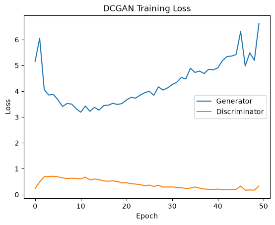
  <figcaption>Figure 1. Training losses for the DC-GAN.</figcaption>
</figure>
<figure>
  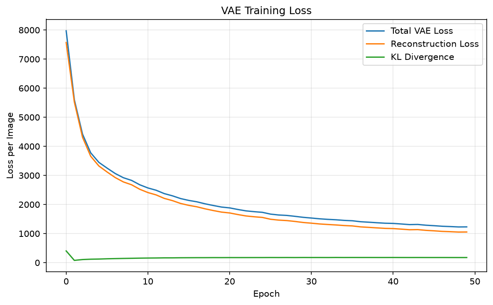
  <figcaption>Figure 1. Training losses for VAE.</figcaption>
</figure>

These shapes are expected; since DC-GAN is competitive, the loss will ideally be relatively flat- neither discriminator nor generator should be too much over-powered; otherwise it can lead to mode collapse. Since the DC-GAN isn't trained to reconstruct images, the loss here indicates how effectively the discriminator detects the generated images.

The VAE training loss data is also consistent; the reconstruction loss per image is reduced greatly after 50 Epochs.

## Visualization of the algorithm and training plots
Generated images after 50 epochs. Since this dataset is data for imaging medical patients, it is logical that week 4 and week 7 data are different; signifying prognosis of the disease; it seems that the week-4 dataset could be quite narrow.

Baseline reconstruction, week 7
<figure>
  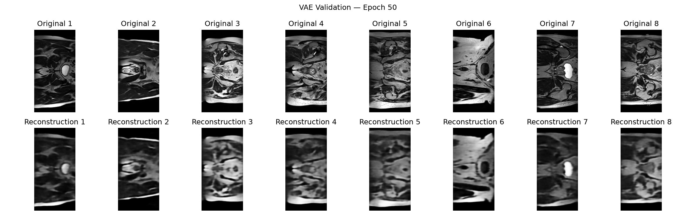
  <figcaption>DC-GAN validation set generated images.</figcaption>
</figure>

Baseline reconstruction, week 4
<figure>
  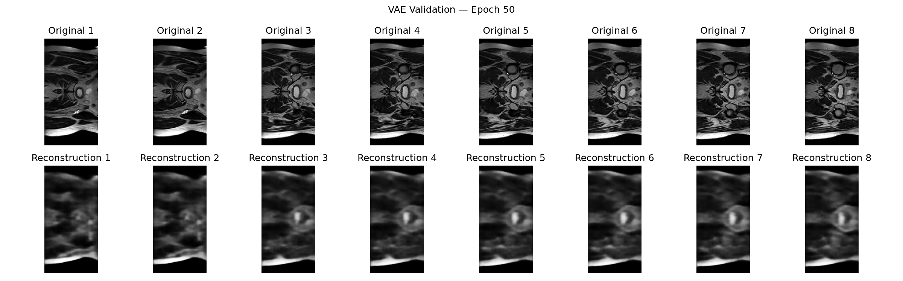
  <figcaption>DC-GAN validation set generated images.</figcaption>
</figure>

DC-GAN:, week 7
<figure>
  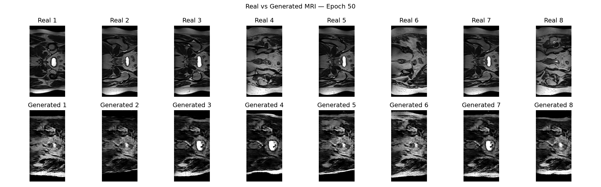
  <figcaption>DC-GAN validation set generated images.</figcaption>
</figure>

DC-GAN:, week 4
<figure>
  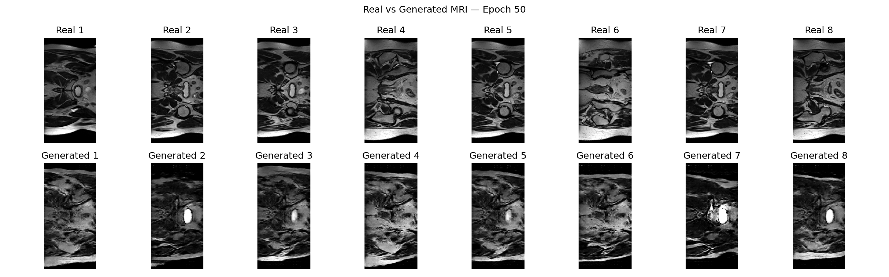
  <figcaption>DC-GAN validation set generated images.</figcaption>
</figure>

### Qualitative analysis
To measure the quality of the images, training loss and training stability were measured during the train phase, and FID, SSIM, and diversity were calculated on the trained model, after training, and during the prediction phase (predict.py); the analysis code can be found in metrics.py.

# Investigation of the Open Research Dilemma
<!-- – Quantitative benchmarking of your chosen model against your implemented baseline model under identical evaluation splits.
– Resource profiling table documenting computational efficiency (peak GPU VRAM, parameter count, and inference runtime/latency).
– In-depth qualitative error autopsies analyzing 3–5 representative failure cases from the dataset (diagnosing root triggers and failure modes).
– Actionable engineering recommendation and trade-off synthesis for your project manager. -->

## SSIM, FID
SSIM (Structural Similarity Index Measure) measures the structural similarity between two images by comparing their luminance, contrast, and structure. It ranges from -1 to 1, with 1 indicating identical images. Higher SSIM values indicate greater similarity.

FID (Fréchet Inception Distance) measures the difference between the feature distributions of real and generated images using features extracted from an Inception network. It compares their means and covariances, with lower FID values indicating that the generated images are more similar to the real image distribution.

## Quantitative Model Comparison
The two models had not performed as well as expected; the VAE model was only able to achieve an SSIM of 0.33 for Week 4, and 0.375 for week 7: this is rather poor for a VAE, and below the expected threshold of 0.6 for image reconstruction.

### Week 4

| Metric | DCGAN | VAE Baseline |
|---|---:|---:|
| FID | 460.4052 | 567.6138 |
| Generation SSIM | 0.1898 | N/A |
| Reconstruction SSIM | N/A | 0.3374 |
| Mean pairwise distance | 0.2286 | 0.0473 |
| Mean nearest-neighbour distance | 0.1461 | 0.0353 |

### Week 7

| Metric | DCGAN | VAE Baseline |
|---|---:|---:|
| FID | 484.3503 | 539.8332 |
| Generation SSIM | 0.1747 | N/A |
| Reconstruction SSIM | N/A | 0.3759 |
| Mean pairwise distance | 0.2308 | 0.0494 |
| Mean nearest-neighbour distance | 0.1559 | 0.0372 |

## Week 7 Results

DC-GAN Generated Images:
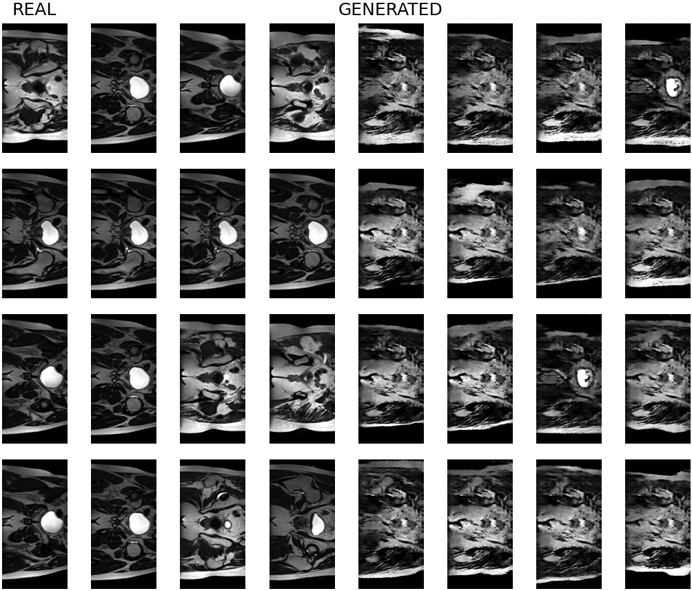

VAE Generated Images (random latent vector)
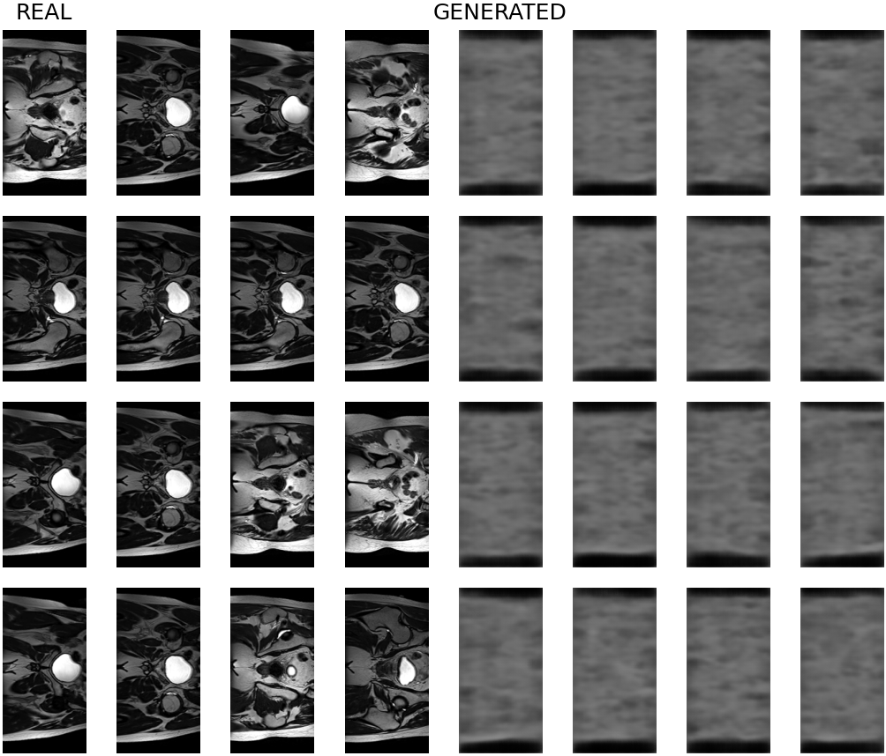

VAE Reconstructed images:
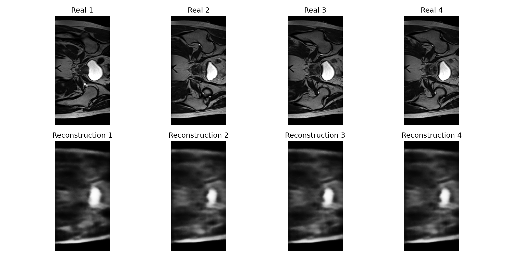

## Computation run time for Training
Both models were trained on the a100 RANGPUR GPU compute cluster (40GB RAM), with cuda. Prediction was fast enough to be done on the laptop (Lenovo Yoga 7, 16GB RAM, No GPU).

There are 1380 Images in the week 4 and week 7 training dataset, and the image ranges were normalized to [-1, 1] as described earlier. Seed was set to 42.

It can be seen that the VAE took slightly less memory and ran faster than training the DC-GAN; but both models took about 3.5 minutes to complete training. The training stability was measured with gradient norms. The week 7 gradient norms are shown;

### DC-GAN training metrics:
- Epochs: 50
- Batch Size: 16
- Peak GPU memory: 0.39 GB
- Training time: 253.83 seconds

### VAE training metrics:
- Epochs: 50
- Batch Size: 16
- Peak GPU memory: 0.34 GB
- Training time: 239.10 seconds

### Gradient Norms
Gradient norms measure the magnitude of the gradients calculated during backpropagation. They indicate how strongly the model's parameters are being updated during training.
- Large gradient norms indicate larger parameter updates. If they become excessively large, this can indicate exploding gradients and unstable training.
- Small gradient norms indicate smaller parameter updates. If they become too small, this can indicate vanishing gradients, potentially slowing or preventing learning.
- Fluctuating gradient norms are normal during training, particularly for GANs, where the generator and discriminator continuously compete.

This was recorded for both models:

Gradient norms, DC-GAN

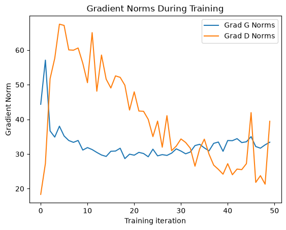

Gradient losses, VAE

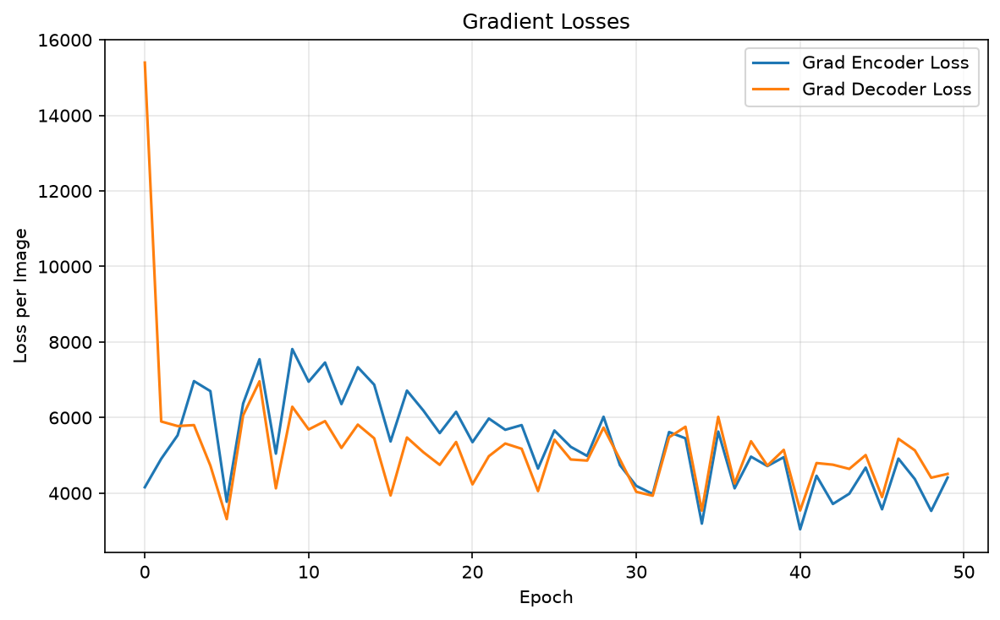

The DC-GAN is inherently less stable than VAE during training; it has high fluctuating norms due to the competitive nature of the generator and discriminator. The VAE has both encoder and decoder loss relatively close to eachother- indicating healthy training is occuring.

### DCGAN: Real vs Generated Diversity

| Metric | Week 4 Real | Week 4 Generated | Week 7 Real | Week 7 Generated |
|---|---:|---:|---:|---:|
| Mean pairwise distance | 0.2573 | 0.2286 | 0.2350 | 0.2308 |
| Mean nearest-neighbour distance | 0.1342 | 0.1461 | 0.1154 | 0.1559 |

## DC-GAN SSIM Scores and latent-inversion
It should be noted that DC-GAN has no original image to compare to. Therefore, it is not meaningful to have a generation SSIM value.

To solve this, Latent-inversion can be used (Found in `latent_inversion.py`). This code walks through through the DCGAN's latent space, optimizing to find the closest matching latent vector that the DC-GAN can generate, that matches.

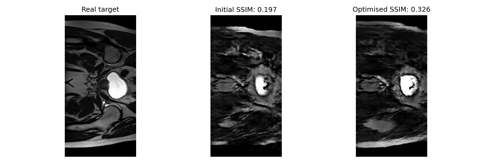

Using this, an SSIM of 0.326 can be acchieved with the DC-GAN model; still far below the expected 0.6. Also, this is just a demonstration of the abilities of the DC-GAN model; practically, the model would not be able to have that many iterations to optimize.

## PCA
For the baseline VAE model, Principal Component Analysis (PCA) was used to explore the latent space and improve the selection of latent vectors for image generation. PCA was applied to the latent vectors (mu) extracted by passing the training dataset through the encoder. It identifies directions in the latent space along which the data varies the most, known as principal components. The first principal component captures the greatest amount of variance, with each subsequent component capturing as much of the remaining variance as possible while remaining orthogonal to the previous components.

The 10 principal components with the highest variance were selected to focus on the most significant patterns in the encoded data. This provides a lower-dimensional representation of the latent space, allowing latent vectors to be sampled or modified along its most informative directions when generating images.

Doing this allows for better generation with VAE; while pure VAE is completely blurry with generated images, upon visual inspection, using this method allows for distinguisable features.

Run with ```bash py -m baseline/predict_with_pca```.

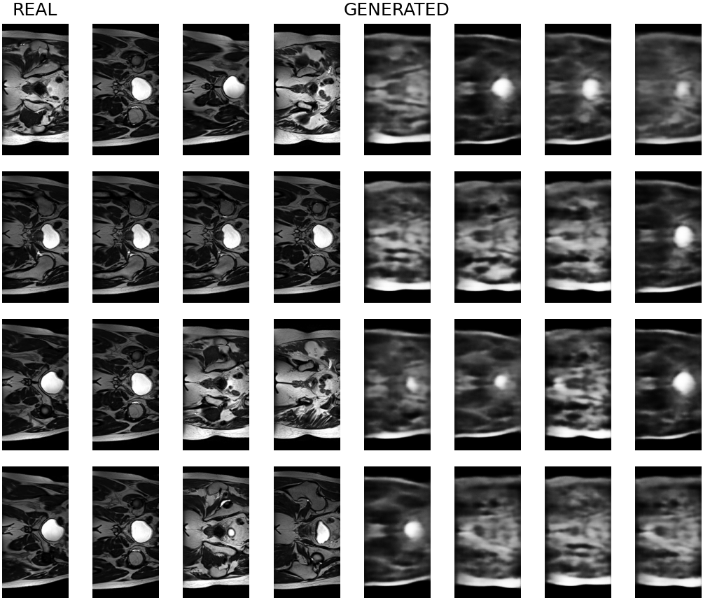

## Model Comparison and Failure autopsy

The results indicate that the DCGAN produced images closer to the real data distribution, achieving lower FID scores than the VAE at both evaluation points. 

For both the week 4 and week 7 datasets, the DC-GAN had a measurably lower FID; implying that it was generating images closer to the test data than the VAE model.

Neither model achieved the expected image quality. Both produced relatively high FID scores, suggesting that their generated images still differed substantially from the real data distribution. 

Overall, the results suggest a potential trade-off between image quality and computational cost. The DCGAN achieved better FID scores, indicating greater similarity to the real image distribution, while the VAE offered a simpler and more computationally efficient training process. However, the VAE's reconstruction quality and both models' FID scores indicate that neither approach produced sufficiently high-quality images. 

## What can be done
Further training, hyperparameter tuning and architectural improvements would be needed to improve the results. The latent dimension was only 100; this is rather low. Also, the specific DC-GAN architecture described here had 5+ layers; the vector describing the image is highly compressed before being passed to the generator; therefore, increasing this could help.

A more complex model, like diffusion or VQ-VAE, could also yield improved results, but this would involve substantial increase in GPU power for training.

# Artifical Intellegence Usage disclosure
<!-- The mandatory Artificial Intelligence Usage Disclosure subsection (see Section 6). -->
AI tools used were: ChatGPT and Github Copilot Autocomplete. Generated code was checked over manually, and the README was drafted with AI, but proof-read by human.

## Tasks that the AI tools were used for:
The AI tools were used for:
- Providing inspiration for how to implement the methods.
- Code checking and Debugging.
- Supplementary Code review. 
- Cursory Feedback on the generated outputs.
- Code scaffolding.
- Writing code comments.
- Generating tables in Markdown for the model architectures.
- Drafting the README, and providing feedback for written details.

## AI-code auditing method
The code was generated by AI; but the expected outputs were looked at manually. Any comments were reviewed manually to ensure that they were correct.

A lot of the code was inspired by [2], where this user did the same project, but using W-GAN instead of DC-GAN, and didn't do a comparison model. However, I did not copy the code from that PR; just used it as inpsiration.

<!-- # Responsible Use of AI and Mandatory Disclosure -->
<!-- Generative AI models are permitted to assist your learning and implementation workflows. However,
the expectations of engineering professionalism apply:
1. Verification Responsibility: 
    You are 100% personally responsible for every line of code, loss formula, and metric in your submission. 
    Blaming an AI model for an incorrect calculation or data leak is unacceptable.
2. Mandatory AI Disclosure Section: In your README.md, you must include a dedicated subsection
    titled “Artificial Intelligence Usage Disclosure” documenting:
    - Which AI tools were utilized (e.g., GitHub Copilot for auto-complete, ChatGPT/Claude for debugging syntax, Gemini for concept lookup).
    - What specific tasks AI assisted with (e.g., scaffolding data loading functions, refactoring plotting scripts).
    - How you audited, verified, and empirically tested the AI-suggested code.
3. Prohibited Misconduct: Copying code from fellow students, reusing previous years’ pull requests,
or committing unverified AI hallucinations. -->

## References
<!-- Put references here. Use the APA Format.-->
<!-- Reference any websites used to do the assignment. -->
[1] Radford, A., Metz, L., & Chintala, S. (2016). Unsupervised representation learning with deep convolutional generative adversarial networks. arXiv. https://arxiv.org/abs/1511.06434

[2] samuel2003-coder. (2025). *PatternAnalysis2025* [recognition]. GitHub. https://github.com/samuel2003-coder/PatternAnalysis-2025/tree/topic-recognition

https://en.wikipedia.org/wiki/Wasserstein_metric

https://lilianweng.github.io/posts/2017-08-20-gan/#what-is-wasserstein-distance
